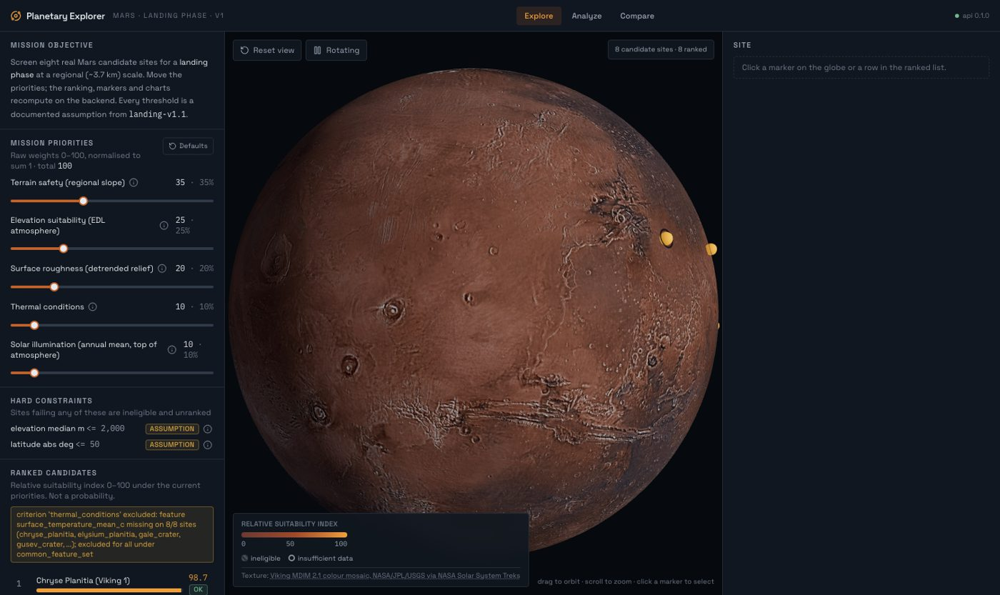
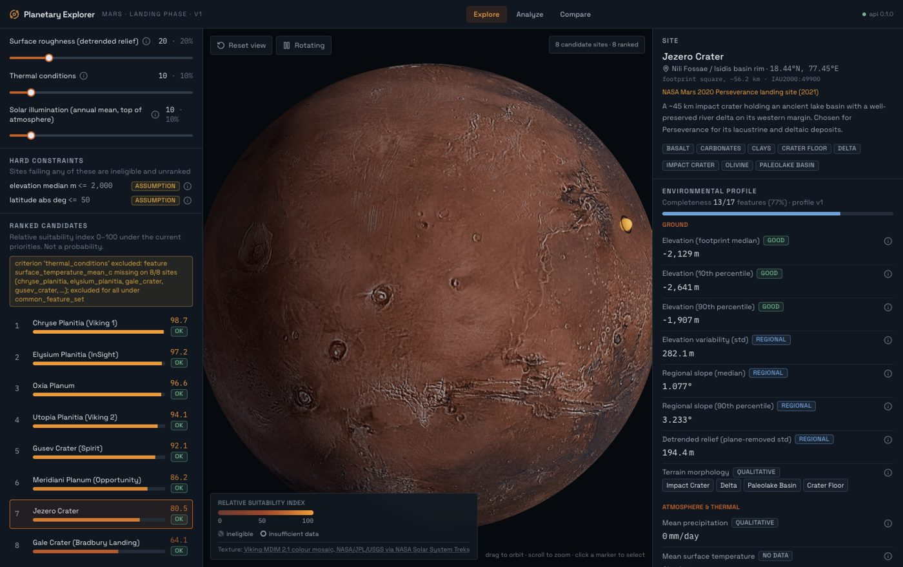
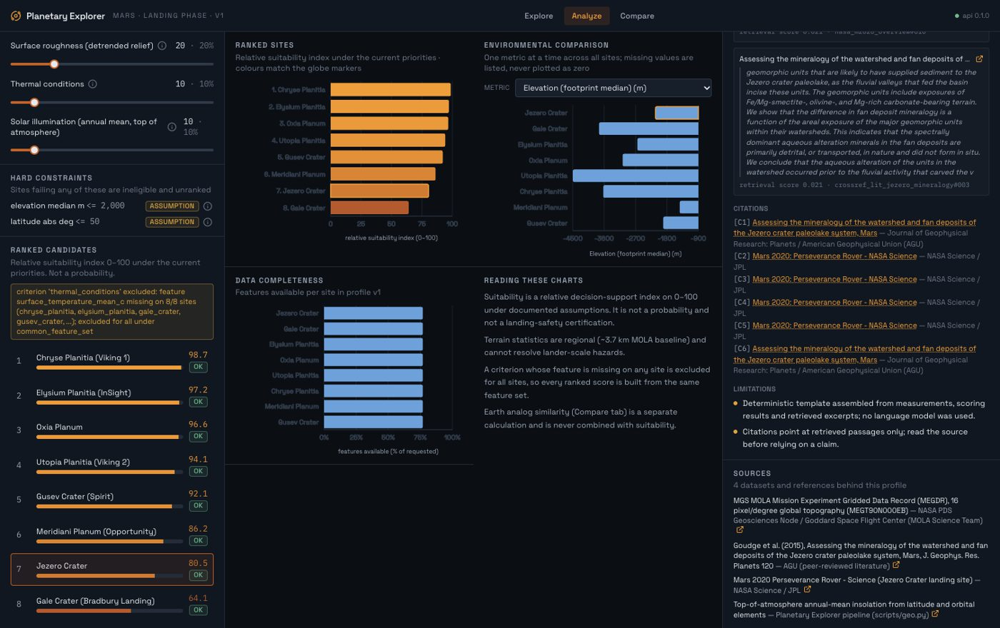
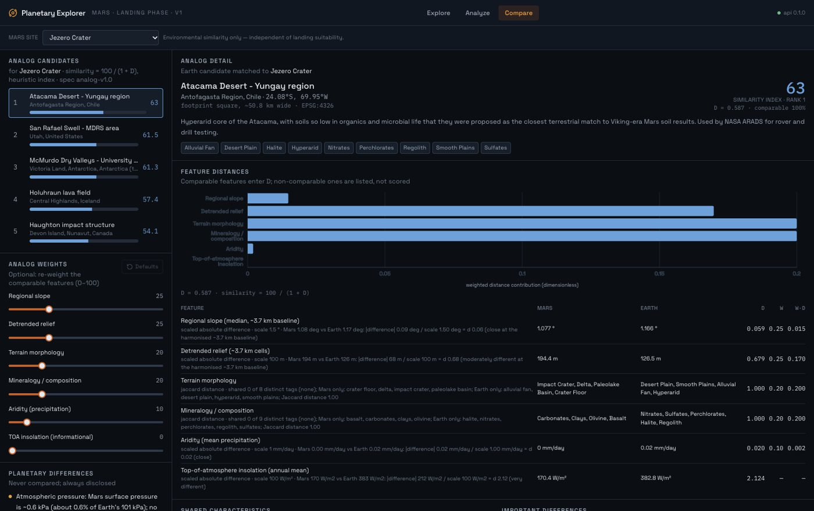
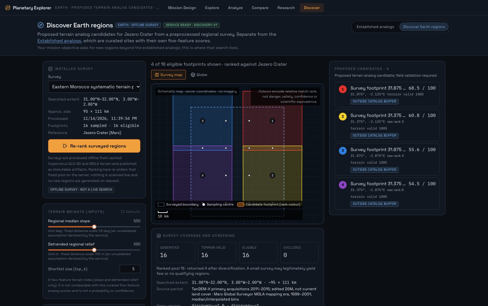
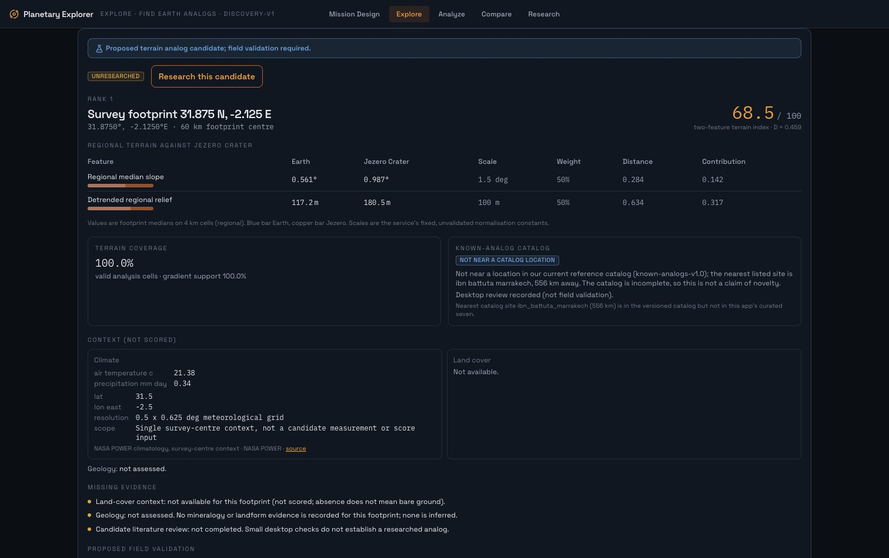
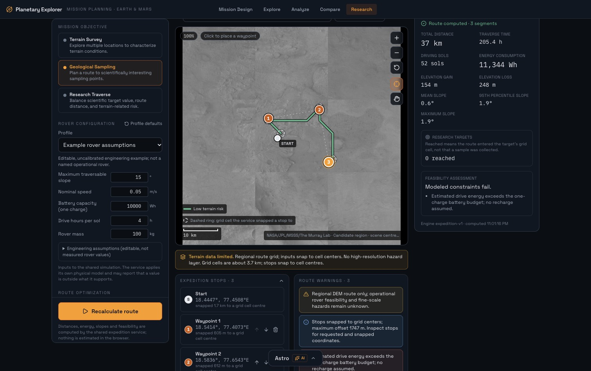
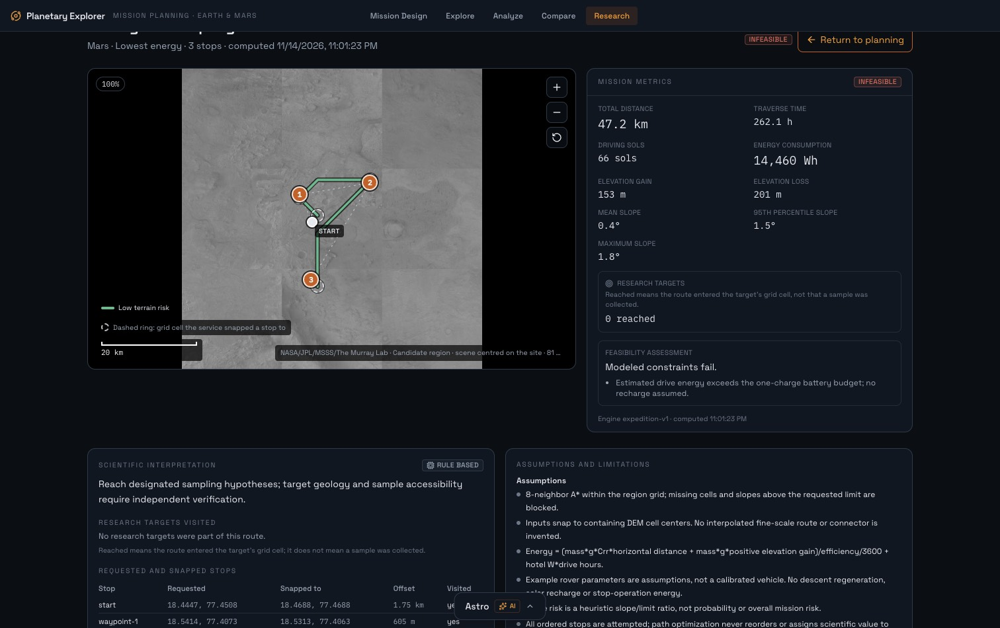

# Planetary Explorer

**NASA Space Apps Challenge 2026** — *Identify Earth Locations that Analog the Permanent Moon Base Locations and Mars*

An AI-assisted web application for exploring Mars, evaluating candidate landing
sites against adjustable mission priorities, and matching them with Earth
analog environments. Every number on screen is traceable to a NASA, ESA, USGS or
peer-reviewed source; every score is a documented, deterministic calculation;
every AI explanation is grounded in retrieved documents and degrades to a
deterministic template when no language model is available.

> **Status: Version 1 (hackathon weekend).** Mars only. Phase 1 (Landing) only.
> See [docs/ROADMAP.md](docs/ROADMAP.md) for what Version 2 adds and
> [docs/TEAM_WORKSTREAMS.md](docs/TEAM_WORKSTREAMS.md) for who owns what.

## What it does

| You can | Backed by |
|---|---|
| Spin a 3D Mars globe with 8 real candidate sites | NASA Trek Viking MDIM 2.1 colour mosaic, MOLA coordinates |
| Inspect each site's environmental profile with units, provenance and quality flags | MOLA MEGDR 16 ppd topography, cited literature for composition |
| See an explainable landing-suitability score and ranking | Deterministic weighted scoring with documented thresholds ([SCIENTIFIC_METHOD.md](docs/SCIENTIFIC_METHOD.md)) |
| Move mission-priority sliders and watch scores, ranks, markers and charts update | `POST /api/v1/scoring/evaluate`, stale-response protection in the client |
| Read a citation-backed scientific explanation | Local retrieval over a curated corpus + optional LLM, with a deterministic fallback |
| Compare a Mars site with curated Earth analog candidates | Copernicus GLO-90 DEM + NASA POWER climatology, harmonised to the MOLA cell size |

## Screenshots

Captured 2026-11-14 from the running app (headless Chrome, backend on committed v1 data).

| Explore | Site selected |
|---|---|
|  |  |

| Analyze | Compare |
|---|---|
|  |  |

## Earth–Mars release (in progress)

The current release adds a real Earth globe (NASA Blue Marble Next Generation), analog matching in
both directions (`POST /api/v1/analogs/rank`: Earth candidates ranked against a Mars reference, or Mars
candidates against an Earth reference, on a common feature basis), a task reader for objectives
(landing screening vs analog-site selection, focus body vs mission destination, named reference
sites), and verified imagery for Earth sites (Landsat WELD orbital context via NASA GIBS, field
photographs with recorded licences). Landing suitability stays Mars-only and is never merged with
analog similarity. The Moon is deferred: its catalogue data is isolated and unused in navigation.

## Find Earth analogs

Under **Explore → Find Unresearched Analogs**, the app ranks an offline, preprocessed Earth terrain survey
(`discovery-v2`: Copernicus GLO-90 footprints on 4 km cells plus NASA POWER climatology, against MOLA at
Jezero). The shipped survey covers **sixteen one-degree regions on five continents**, chosen for the Mars
process or surface each is known to express — desert pavement on the Tademaït, yardangs in the Dasht-e Lut,
evaporite playa in the Qaidam, megadunes at Badain Jaran, lava tubes at Harrat Khaybar, relict drainage in
the Ennedi — and deliberately away from Antarctica, the Atacama proper, Iceland and Hawaii. Each region's
hypothesis was written down before any terrain was processed or any score seen.

Candidates are scored on **six measured features across three dimensions** — terrain and landform
(median slope, steep-tail slope, detrended relief, elevation range), illumination (distance from the
equator) and water (mean precipitation) — and each dimension is also scored on its own, so the app can say
a region is an excellent aridity analog and only a fair terrain one. Dimensions with no measured Mars
counterpart in this release (air temperature, wind, surface shortwave) are reported beside every candidate
as differences and never enter the index; neither does top-of-atmosphere insolation, which is measured on
both bodies but differs by about 2.2× no matter which Earth site you pick.

The page shows each searched region's outline (never a single box drawn around them all), the exact
sampling coverage, screening counts, each candidate's real footprint and factor contributions, data
sources, its relationship to the versioned known-analog catalog, missing evidence and proposed field
validation. Every result is labelled *Proposed terrain analog candidate; field validation required*, kept
apart from the established analogs and their five-feature scores, and nothing is scanned live. Browse
Regions, the other Explore mode, keeps the featured regions and the established analogs.
See [docs/DISCOVERY_UI.md](docs/DISCOVERY_UI.md) and [DISCOVERY_CONTRACT.md](DISCOVERY_CONTRACT.md).

| Ranked survey | Candidate evidence |
|---|---|
|  |  |

## Expedition Planner

From a site's **Research** page, **Plan an Expedition** opens an interactive rover-expedition planner: choose an
objective (terrain survey, geological sampling, research traverse), lay out waypoints on the region's
georeferenced CTX mosaic, set rover limits, and let the shared expedition service (`expedition-v1`, MOLA regional
grid, A* routing) compute the route, its slopes, energy and feasibility. Every metric on screen is the service's;
the UI estimates nothing. See [docs/EXPEDITION_PLANNER_UI.md](docs/EXPEDITION_PLANNER_UI.md) and
[EXPEDITION_PLANNER_CONTRACT.md](EXPEDITION_PLANNER_CONTRACT.md).

| Workspace | Mission report |
|---|---|
|  |  |

## Theme

The whole interface reads one token file, `frontend/src/theme.css`; see [docs/THEME.md](docs/THEME.md).

## Quick start

```bash
# Backend (Python 3.11+)
cd backend
python -m venv .venv && source .venv/bin/activate
pip install -r requirements.txt
python -m pytest -q                      # 244 tests over the committed data
uvicorn app.main:app --reload            # http://localhost:8000/docs

# Frontend (Node 20+)
cd ../frontend
npm install
npm run dev                              # http://localhost:5173
```

Copy `.env.example` to `.env` to configure CORS, the LLM key (optional) and
the embedding backend. **The app runs fully without any API key.**

## Reproducing the data

The preprocessed profiles under `backend/data/` are committed so the app and
the tests run offline. To rebuild them from the original sources:

```bash
cd backend && source .venv/bin/activate
python scripts/fetch_mola.py              # 33 MB MOLA MEGDR 16 ppd grid from NASA PDS
python scripts/build_mars_profiles.py     # footprint statistics -> data/mars/site_profiles.v1.json
python scripts/build_earth_profiles.py    # Copernicus DEM + NASA POWER -> data/earth/candidate_profiles.v1.json
python scripts/fetch_mars_texture.py      # 4K globe texture from NASA Trek WMTS tiles
python scripts/ingest_documents.py        # curated corpus -> data/documents/chunks.jsonl
```

Each dataset's institution, instrument, resolution, units, coverage, caveats
and licence are recorded in [docs/DATA_SOURCES.md](docs/DATA_SOURCES.md).

## Repository layout

```
frontend/   React + TypeScript + Vite, React Three Fiber globe, Recharts, Zustand, TanStack Query
backend/    FastAPI + Pydantic v2; data pipeline scripts; deterministic engines; retrieval + explanation
docs/       ARCHITECTURE, DATA_SOURCES, SCIENTIFIC_METHOD, API_CONTRACTS, TEAM_WORKSTREAMS, ROADMAP
```

## Scientific integrity rules (summary)

- Missing data is `null` and is reported; it is never zero and never imputed.
- Scores are relative decision-support indices under documented assumptions,
  not probabilities and not landing-safety certifications.
- Terrain statistics are regional (~3.7 km MOLA baseline) and say so on every metric.
- Landing suitability and Earth-analog similarity are separate calculations.
- The LLM cannot produce numbers, change scores or cite anything that was not retrieved.
- Anything marked `demo_fixture` is for development only and is labelled as such in the UI.

## Licence and attribution

Code: MIT. Data: see per-dataset licences in `docs/DATA_SOURCES.md` (NASA PDS
and POWER data are public domain; Copernicus DEM requires attribution; the
Viking MDIM mosaic is courtesy NASA/JPL/USGS via Solar System Treks).
